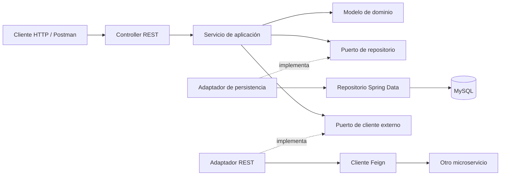
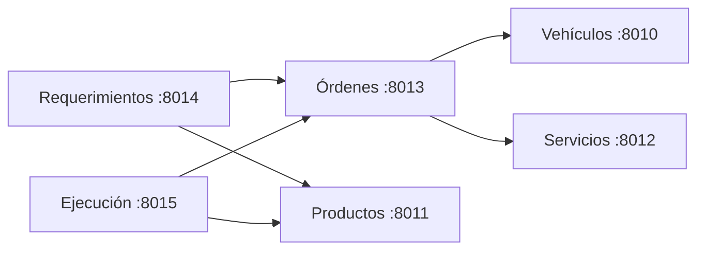

# Lubrimax · Arquitectura hexagonal

Backend para gestionar el mantenimiento de vehículos: desde el registro del vehículo y la solicitud de atención hasta la autorización, los requerimientos de productos y la ejecución del trabajo.

El proyecto está organizado en **seis microservicios Spring Boot**, con APIs REST, comunicación HTTP mediante OpenFeign y una base de datos MySQL por servicio. Cada módulo separa el modelo de negocio de sus mecanismos de persistencia y comunicación mediante puertos y adaptadores.

## Contenido

- [Funcionalidades](#funcionalidades)
- [Cómo está construido](#cómo-está-construido)
- [Microservicios](#microservicios)
- [Estructura del proyecto](#estructura-del-proyecto)
- [Modelo y persistencia](#modelo-y-persistencia)
- [Requisitos](#requisitos)
- [Configuración y ejecución local](#configuración-y-ejecución-local)
- [Datos de prueba](#datos-de-prueba)
- [API REST](#api-rest)
- [Ejemplos para Postman](#ejemplos-para-postman)
- [Reglas de negocio](#reglas-de-negocio)
- [Verificación y solución de problemas](#verificación-y-solución-de-problemas)
- [Alcance actual y contribuciones](#alcance-actual-y-contribuciones)

## Funcionalidades

- Registrar vehículos y conservar su ficha técnica.
- Administrar productos y sus distintas presentaciones.
- Definir servicios de mantenimiento y los tipos de productos que requieren.
- Registrar órdenes con los datos del cliente, una propuesta técnica y su autorización.
- Gestionar cantidades requeridas, disponibilidad y reservas de productos.
- Registrar ejecuciones, tareas, consumos reales y liquidaciones.
- Guardar la fecha y el kilometraje sugeridos para el próximo servicio.

El flujo funcional es: **catálogos → orden → propuesta y autorización → ejecución y liquidación**. Los requerimientos registran los materiales asociados a una orden. En la implementación actual, ejecución consulta órdenes y productos; no consulta directamente el microservicio de requerimientos.

## Cómo está construido

El [POM raíz](pom.xml) es un proyecto Maven agregador con `packaging=pom`: reúne los seis módulos y centraliza la versión de Java y la configuración de Lombok. Cada microservicio hereda de ese POM y tiene su propia clase `@SpringBootApplication`, configuración y artefacto ejecutable.

### Tecnologías declaradas en el proyecto

| Tecnología | Versión o uso |
|---|---|
| Java | 17 |
| Spring Boot | 4.1.1, declarada en el POM raíz |
| Spring Cloud | 2025.1.3, declarada en los módulos |
| Spring Web MVC | Controladores REST y respuestas HTTP |
| Spring Data JPA / Hibernate | Persistencia y mapeo de entidades |
| Spring Cloud OpenFeign | Clientes HTTP entre microservicios |
| MySQL Connector/J | Conexión con MySQL |
| Lombok | Constructores, getters y setters; procesamiento de anotaciones |
| Maven Wrapper | Maven 3.9.16, configurado en cada microservicio |
| Spring Boot DevTools | Soporte durante el desarrollo |

Los módulos también declaran el starter de validación. Las reglas actuales se implementan principalmente mediante métodos del dominio y de los servicios de aplicación.

### Puertos y adaptadores



| Capa | Responsabilidad |
|---|---|
| `domain/model` | Entidades de negocio, objetos de valor, estados y reglas. No contiene el mapeo JPA. |
| `application/port` | Interfaces para persistencia y consultas a otros microservicios. |
| `application/service` | Casos de uso, coordinación de validaciones y llamadas a los puertos. |
| `infrastructure/controller` | Endpoints REST y traducción de excepciones a respuestas HTTP. |
| `infrastructure/adapter` | Implementaciones de los puertos, conversión dominio/JPA y clientes externos. |
| `infrastructure/entity` | Entidades JPA, embebidos, columnas y relaciones. |
| `infrastructure/repository` | Interfaces de Spring Data que acceden a MySQL. |

Por ejemplo, `VehiculoService` utiliza `VehiculoRepositoryPort`; `VehiculoCrudAdapter` implementa ese contrato y transforma `Vehiculo` en `VehiculoEntity` para persistirlo. Los servicios de aplicación usan anotaciones Spring, mientras que los modelos de dominio no dependen de JPA.

## Microservicios

| Módulo | Responsabilidad | Puerto | Base MySQL | Ruta base |
|---|---|---:|---|---|
| [msvc-vehiculos](msvc-vehiculos/) | Vehículos y fichas técnicas | 8010 | `msvc_vehiculos` | `/api/vehiculos` |
| [msvc-productos](msvc-productos/) | Productos y presentaciones | 8011 | `msvc_productos` | `/api/productos` |
| [msvc-servicios](msvc-servicios/) | Catálogo de servicios y tipos de productos requeridos | 8012 | `msvc_servicios` | `/api/servicios` |
| [msvc-ordenes](msvc-ordenes/) | Órdenes, propuestas y autorizaciones | 8013 | `msvc_ordenes` | `/api/ordenes` |
| [msvc-requerimientos](msvc-requerimientos/) | Materiales, disponibilidad y reservas | 8014 | `msvc_requerimientos` | `/api/requerimientos` |
| [msvc-ejecucion](msvc-ejecucion/) | Ejecuciones, tareas, consumos y liquidaciones | 8015 | `msvc_ejecucion` | `/api/ejecuciones` |

Las flechas siguientes representan consultas HTTP salientes:



Las URLs se configuran por servicio. Las referencias entre bases se mantienen mediante IDs y validaciones de aplicación; no hay claves foráneas físicas entre microservicios ni una transacción distribuida que abarque sus bases.

## Estructura del proyecto

```text
lubrimax-hexagonal/
├── pom.xml                         # Agregador Maven y configuración compartida
├── README.md                       # Documentación general
├── lubrimax_datos_prueba.sql        # Recreación de bases y datos de prueba
├── msvc-vehiculos/
├── msvc-productos/
├── msvc-servicios/
├── msvc-ordenes/
├── msvc-requerimientos/
└── msvc-ejecucion/
```

Cada microservicio sigue esta estructura; los clientes externos aparecen en los módulos que los necesitan:

```text
msvc-<nombre>/
├── pom.xml
├── mvnw / mvnw.cmd
├── .mvn/wrapper/maven-wrapper.properties
└── src/main/
    ├── java/org/lubrimax/com/
    │   ├── Msvc...Application.java
    │   ├── domain/model/
    │   ├── application/
    │   │   ├── port/
    │   │   └── service/
    │   └── infrastructure/
    │       ├── adapter/
    │       ├── controller/
    │       ├── entity/
    │       └── repository/
    └── resources/application.properties
```

## Modelo y persistencia

El esquema incluye **12 entidades JPA y 4 tablas de colecciones**, distribuidas en seis bases:

| Base | Tablas persistentes |
|---|---|
| `msvc_vehiculos` | `vehiculo` |
| `msvc_productos` | `producto`, `presentacion_producto` |
| `msvc_servicios` | `servicio_mantenimiento`, `servicio_tipo_producto_requerido` |
| `msvc_ordenes` | `orden_servicio`, `propuesta_tecnica`, `autorizacion`, `orden_servicios`, `propuesta_servicios`, `autorizacion_servicios` |
| `msvc_requerimientos` | `requerimiento_mantenimiento`, `detalle_requerimiento` |
| `msvc_ejecucion` | `ejecucion_mantenimiento`, `tarea_ejecutada`, `consumo_real` |

Aspectos del mapeo:

- `FichaTecnicaEntity` es `@Embeddable`: sus datos se guardan en `vehiculo`, no en una tabla independiente.
- `DatosDelClienteEmbeddable` se almacena en `orden_servicio`.
- `LiquidacionDeServicioEmbeddable` y `ProgramacionDeProximoServicioEmbeddable` se almacenan en `ejecucion_mantenimiento`.
- Producto/presentaciones, requerimiento/detalles y ejecución/tareas/consumos tienen relaciones uno a muchos.
- Una orden puede tener una propuesta y una autorización mediante relaciones uno a uno opcionales.
- Las colecciones de servicios y tipos requeridos conservan su orden mediante la columna `posicion`, que comienza en cero.
- Las entidades tienen IDs autogenerados. Las placas, los códigos de producto y la orden asociada a una ejecución tienen restricciones de unicidad.

## Requisitos

- JDK 17 y `JAVA_HOME` configurado.
- MySQL 8.0 para usar el script de datos incluido.
- Acceso a los repositorios Maven para descargar herramientas y dependencias durante la primera compilación.
- Puertos `8010` a `8015` disponibles; MySQL utiliza `3306` por defecto.
- Postman, un cliente HTTP o PowerShell para probar la API.

No es necesario instalar Maven por separado si se usa el Wrapper incluido en los módulos. No hay un ejecutable `mvnw` en la raíz: los comandos siguientes utilizan el de `msvc-vehiculos` para compilar el agregador.

## Configuración y ejecución local

### 1. Obtener el proyecto

Clona este repositorio con la URL de GitHub donde esté publicado, o descarga y descomprime su contenido. Abre una terminal en la carpeta que contiene el `pom.xml` raíz:

```powershell
cd lubrimax-hexagonal
java -version
```

### 2. Configurar MySQL

Cada módulo contiene su configuración en `src/main/resources/application.properties`. Por ejemplo, vehículos utiliza:

```properties
spring.datasource.url=jdbc:mysql://localhost:3306/msvc_vehiculos?createDatabaseIfNotExist=true
spring.datasource.username=root
spring.datasource.password=${password}
spring.jpa.generate-ddl=true
```

La contraseña se proporciona mediante la variable `password`. En **cada terminal** desde la que se ejecute un microservicio, configura:

```powershell
$env:password = 'TU_CLAVE_LOCAL_DE_MYSQL'
```

En Bash:

```bash
export password='TU_CLAVE_LOCAL_DE_MYSQL'
```

Reemplaza el valor de ejemplo por tu contraseña local. En un IDE, define la misma variable de entorno en cada configuración de ejecución. No guardes credenciales reales en archivos del repositorio. El proyecto no incorpora un cargador de archivos `.env`.

También puedes sobrescribir la configuración de conexión mediante `SPRING_DATASOURCE_URL`, `SPRING_DATASOURCE_USERNAME` y `SPRING_DATASOURCE_PASSWORD`. La URL debe apuntar a la base del microservicio correspondiente; no reutilices una única base para todos.

El usuario MySQL debe tener permisos sobre las bases configuradas. La opción `createDatabaseIfNotExist=true` requiere permiso de creación si la base no existe. La generación DDL está habilitada; el script SQL es la opción para comenzar con los datos de demostración.

### 3. Cargar los datos de prueba, si se necesitan

Con los microservicios detenidos, abre [lubrimax_datos_prueba.sql](lubrimax_datos_prueba.sql) en MySQL Workbench y ejecútalo completo contra una instancia de pruebas.

> **El script contiene `DROP DATABASE`: elimina y recrea las seis bases del proyecto. No lo ejecutes sobre datos que quieras conservar.**

Alternativamente, desde la raíz, abre el cliente MySQL:

```shell
mysql --default-character-set=utf8mb4 -u root -p
```

Dentro del cliente:

```sql
SOURCE lubrimax_datos_prueba.sql;
```

No se carga automáticamente al arrancar Spring Boot. Al terminar, el script muestra verificaciones de integridad y recuentos; todas las filas de `violaciones` deben valer `0`.

### 4. Compilar los seis módulos

Desde la raíz, en PowerShell:

```powershell
.\msvc-vehiculos\mvnw.cmd -f .\pom.xml clean package
```

En Linux o macOS, desde la misma carpeta:

```bash
bash ./msvc-vehiculos/mvnw -f ./pom.xml clean package
```

Si ya tienes Maven instalado, el equivalente es `mvn clean package`. La compilación genera un JAR por microservicio en su carpeta `target/`; el POM raíz no representa una aplicación ejecutable.

### 5. Arrancar los microservicios

Ejecuta **cada comando en una terminal distinta**, desde la raíz y con la variable de contraseña configurada. Inicia primero los catálogos, luego órdenes y finalmente requerimientos y ejecución:

```shell
java -jar msvc-vehiculos/target/msvc-vehiculos-0.0.1-SNAPSHOT.jar
```

```shell
java -jar msvc-productos/target/msvc-productos-0.0.1-SNAPSHOT.jar
```

```shell
java -jar msvc-servicios/target/msvc-servicios-0.0.1-SNAPSHOT.jar
```

```shell
java -jar msvc-ordenes/target/msvc-ordenes-0.0.1-SNAPSHOT.jar
```

```shell
java -jar msvc-requerimientos/target/msvc-requerimientos-0.0.1-SNAPSHOT.jar
```

```shell
java -jar msvc-ejecucion/target/msvc-ejecucion-0.0.1-SNAPSHOT.jar
```

También puedes importar el POM raíz en tu IDE y ejecutar las seis clases `Msvc...Application`. Para trabajar con Lombok, el IDE debe reconocer el procesamiento de anotaciones.

### URLs de otros microservicios

| Variable | Valor predeterminado | Consumidor |
|---|---|---|
| `VEHICULOS_URL` | `http://localhost:8010` | Órdenes |
| `SERVICIOS_URL` | `http://localhost:8012` | Órdenes |
| `ORDENES_URL` | `http://localhost:8013` | Requerimientos y ejecución |
| `PRODUCTOS_URL` | `http://localhost:8011` | Requerimientos y ejecución |

Si cambias un puerto o un host, ajusta estas variables en los servicios consumidores. Feign tiene configurados tiempos máximos de conexión de 2000 ms y de lectura de 3000 ms.

## Datos de prueba

El script incluye **376 registros en las 16 tablas**, con vehículos, productos, presentaciones, servicios y escenarios relacionados de mantenimiento.

| Escenario | Cantidad | IDs útiles |
|---|---:|---|
| Órdenes sin autorización | 6 | Órdenes `1–6` |
| Órdenes autorizadas | 18 | Órdenes `7–24` |
| Autorizadas sin ejecución | 3 | Órdenes `7–9` |
| Ejecuciones `PENDIENTE` | 11 | Ejecuciones `1–11` |
| Ejecuciones `EN_PROCESO` | 2 | Ejecuciones `12–13` |
| Ejecuciones `FINALIZADA` | 2 | Ejecuciones `14–15` |

La orden `7` muestra una autorización parcial: autoriza un subconjunto de los servicios propuestos. Las ejecuciones pendientes tienen fechas nulas, importes cero, tareas pendientes y ningún consumo. También hay detalles con disponibilidad parcial o faltante y una tarea `NO_REALIZADA`.

Los IDs anteriores corresponden a una carga recién realizada; pueden dejar de representar esos escenarios después de modificar los datos por la API.

## API REST

### Operaciones comunes

Los seis recursos de la tabla de microservicios exponen estas operaciones:

| Método | Ruta relativa a la ruta base | Operación |
|---|---|---|
| `GET` | `/` | Listar registros; no hay paginación implementada |
| `GET` | `/{id}` | Buscar por ID |
| `POST` | `/` | Crear un registro |
| `PUT` | `/{id}` | Actualizar el agregado |
| `DELETE` | `/{id}` | Eliminar un registro |

Para listar o crear, utiliza directamente la ruta base, por ejemplo `http://localhost:8010/api/vehiculos`, sin necesidad de añadir una barra final.

Los cuerpos se envían como JSON con `Content-Type: application/json`. En las altas, omite los IDs autogenerados o envíalos como `null`. Los `PUT` generales reciben el modelo completo: no son actualizaciones parciales y sus colecciones pueden reemplazar los elementos existentes. Conserva los IDs de los hijos que quieras actualizar y omítelos para hijos nuevos.

### Órdenes: autorización

| Método | Ruta | Cuerpo |
|---|---|---|
| `GET` | `/api/ordenes/{id}/autorizada` | Sin cuerpo; devuelve un booleano |
| `PUT` | `/api/ordenes/{id}/autorizar` | Objeto `Autorizacion`: `medio`, `alcance`, `fecha`, `servicioIds` |

### Ejecución: operaciones de negocio

| Método | Ruta | Cuerpo |
|---|---|---|
| `PUT` | `/api/ejecuciones/{id}/iniciar` | `{"fechaInicio":"2026-10-30T09:00:00"}` |
| `PUT` | `/api/ejecuciones/{id}/finalizar` | `{"fechaFin":"2026-10-30T11:00:00"}` |
| `PUT` | `/api/ejecuciones/{id}/cancelar` | Sin cuerpo |
| `PUT` | `/api/ejecuciones/{ejecucionId}/tareas/{tareaId}/iniciar` | `{"fechaInicio":"2026-10-30T09:10:00"}` |
| `PUT` | `/api/ejecuciones/{ejecucionId}/tareas/{tareaId}/finalizar` | `{"fechaFin":"2026-10-30T09:30:00"}` |
| `PUT` | `/api/ejecuciones/{ejecucionId}/tareas/{tareaId}/no-realizada` | Sin cuerpo |
| `POST` | `/api/ejecuciones/{id}/consumos` | `productoId`, `presentacionId`, `cantidadReal`, `precioAplicado` |

En el modelo JSON de una tarea, las fechas se llaman `inicio` y `fin`. Los endpoints de acción reciben `fechaInicio` o `fechaFin`, como muestra la tabla. Las fechas con hora usan `LocalDateTime`, sin zona horaria; la fecha sugerida del próximo servicio usa `YYYY-MM-DD`.

### Respuestas

| Código | Uso |
|---|---|
| `200 OK` | Consulta, actualización o acción correcta |
| `201 Created` | Alta de un agregado, con cabecera `Location` |
| `204 No Content` | Eliminación correcta |
| `400 Bad Request` | Datos inválidos o una referencia externa rechazada por la aplicación |
| `404 Not Found` | Recurso principal solicitado inexistente |
| `409 Conflict` | Conflicto de estado, duplicidad o integridad de datos |
| `503 Service Unavailable` | Fallo al consultar una dependencia HTTP, en los servicios que usan clientes externos |

Los manejadores de excepciones del proyecto devuelven errores de negocio con esta forma:

```json
{
  "mensaje": "La orden no existe o no está autorizada."
}
```

## Ejemplos para Postman

Estos ejemplos suponen que se cargó el SQL y que los microservicios están en ejecución.

### Consultar y comprobar autorización

```http
GET http://localhost:8010/api/vehiculos
GET http://localhost:8011/api/productos
GET http://localhost:8013/api/ordenes/7
GET http://localhost:8013/api/ordenes/7/autorizada
```

La última consulta devuelve `true` con los datos iniciales. Para la orden `1`, devuelve `false`.

### Autorizar una orden pendiente

La orden `3` ya tiene una propuesta con el servicio `4`. En Postman selecciona **Body → raw → JSON**:

```http
PUT http://localhost:8013/api/ordenes/3/autorizar
Content-Type: application/json
```

```json
{
  "medio": "PRESENCIAL",
  "alcance": "Autoriza el servicio de líquido de frenos propuesto.",
  "fecha": "2026-10-30T08:30:00",
  "servicioIds": [4]
}
```

### Crear una ejecución pendiente

La orden `7` está autorizada y no tiene ejecución en la carga inicial. Este ejemplo debe enviarse una sola vez para esa orden:

```http
POST http://localhost:8015/api/ejecuciones
Content-Type: application/json
```

```json
{
  "ordenId": 7,
  "tecnicoId": 1,
  "estado": "PENDIENTE",
  "fechaInicio": null,
  "fechaFin": null,
  "liquidacion": {
    "subtotalProductos": 0,
    "subtotalManoObra": 0,
    "total": 0
  },
  "proximoServicio": null,
  "tareas": [
    {
      "tipoTarea": "Cambio de aceite y filtro",
      "estado": "PENDIENTE",
      "inicio": null,
      "fin": null
    }
  ],
  "consumos": []
}
```

Guarda el `ejecucionId` y los `tareaId` de la respuesta. Para avanzar, utiliza los endpoints de inicio y finalización con esos IDs. Inicia la ejecución antes de sus tareas y cierra las tareas antes de finalizar la ejecución, manteniendo sus fechas dentro del intervalo de trabajo.

## Reglas de negocio

- **Autorización:** una orden puede existir sin autorización. Para que `estaAutorizada()` sea verdadero necesita estado `AUTORIZADA`, una autorización válida y servicios autorizados incluidos en la propuesta.
- **Ejecución:** las altas y actualizaciones generales verifican que la orden esté autorizada. Solo puede existir una ejecución por orden.
- **Estados de ejecución:** `PENDIENTE`, `EN_PROCESO`, `FINALIZADA` y `CANCELADA`. Las transiciones permiten pendiente → en proceso/cancelada y en proceso → finalizada/cancelada. También se permite conservar el mismo estado.
- **Estados de tarea:** `PENDIENTE`, `EN_PROCESO`, `FINALIZADA` y `NO_REALIZADA`. Desde pendiente puede pasar a cualquiera de los otros tres; desde en proceso, a finalizada o no realizada. Los estados finales no permiten volver atrás, aunque sí conservarse.
- **Cierre:** la validación del agregado exige fechas coherentes y que una ejecución finalizada no tenga tareas pendientes o en proceso.
- **Disponibilidad:** `FALTANTE` si la cantidad disponible es cero; `PARCIAL` si no alcanza lo requerido; `DISPONIBLE` si alcanza. Solo se puede reservar cuando está disponible.
- **Productos:** las presentaciones usadas en requerimientos y consumos deben pertenecer al producto indicado.
- **Liquidación:** al crear o actualizar una ejecución mediante el endpoint general, se calcula el subtotal de productos sumando `cantidadReal × precioAplicado`, con redondeo `HALF_UP` a dos decimales, y se añade la mano de obra.
- **Técnicos:** `tecnicoId` debe ser positivo. No existe un catálogo ni un microservicio de técnicos en este repositorio.

Los estados de vehículos, productos, servicios, órdenes, propuestas y requerimientos son campos `String`; no tienen enums propios. Los valores del SQL son ejemplos aceptados por las validaciones actuales.

## Verificación y solución de problemas

### Comprobación rápida

En PowerShell, con los servicios levantados:

```powershell
Invoke-RestMethod http://localhost:8010/api/vehiculos
Invoke-RestMethod http://localhost:8013/api/ordenes/7/autorizada
Invoke-RestMethod http://localhost:8015/api/ejecuciones/1
```

La primera llamada comprueba el catálogo; la segunda, la autorización de una orden del SQL; la tercera, la lectura de una ejecución con sus tareas y liquidación.

El SQL incluye 51 consultas de control de integridad. Su carga inicial fue verificada en una instancia aislada de MySQL 8.0, incluyendo una segunda recreación, y sus datos se comprobaron contra validaciones Java del dominio. Esto no equivale a una prueba integral de todos los endpoints.

Actualmente no hay una suite de pruebas automatizadas en `src/test`. Ejecutar `mvn test` por sí solo no demuestra la cobertura funcional del sistema.

| Problema | Qué revisar |
|---|---|
| No se resuelve `${password}` | Define `password` en la terminal o configuración del IDE que inicia el servicio. |
| MySQL rechaza la conexión | Comprueba que esté iniciado, la URL, el puerto, las credenciales y los permisos del usuario. |
| Puerto ocupado | Libera el puerto o cambia `server.port`; ajusta también las URLs de los consumidores. |
| Respuesta `503` | Verifica que el microservicio consultado esté disponible y que su URL sea correcta. |
| Conflicto al crear una ejecución | Comprueba que la orden no tenga ya una ejecución. |
| Orden no autorizada | Revisa estado, propuesta, autorización y servicios autorizados. |
| Error al resolver dependencias Maven | Revisa conectividad, proxy o mirror, y la disponibilidad de las versiones declaradas en los POM. |
| El IDE no reconoce getters o constructores | Recarga Maven y comprueba el procesamiento de anotaciones de Lombok. |

### Consideraciones de la implementación actual

Las acciones específicas no recorren siempre las mismas validaciones que el `PUT` general. En particular, registrar un consumo mediante `POST /api/ejecuciones/{id}/consumos` lo persiste sin recalcular automáticamente la liquidación; el cálculo sí se realiza en el alta y la actualización general de la ejecución. Las acciones individuales de tareas tampoco validan por sí solas todo el intervalo del agregado. Al probar esos flujos, revisa el resultado y conserva fechas e importes coherentes.

Las referencias entre microservicios no tienen protección mediante FK entre bases: eliminar un catálogo referenciado puede dejar IDs sin correspondencia. Los borrados deben considerar esas dependencias.

## Alcance actual y contribuciones

Este repositorio contiene el backend. No incluye frontend, autenticación/autorización de usuarios, API Gateway, descubrimiento de servicios, Docker Compose, documentación Swagger/OpenAPI ni migraciones Flyway/Liquibase. La autorización de una orden es una regla de negocio, no un mecanismo de seguridad de acceso a la API.

Para contribuir, mantén la separación entre dominio, puertos y adaptadores. Si cambias una entidad o una regla, actualiza también su mapeo de persistencia, los datos de prueba y los ejemplos afectados. Describe en el pull request qué comportamiento cambia y cómo lo verificaste.

El repositorio no incluye actualmente un archivo `LICENSE`; no se declara una licencia de distribución en este README.
